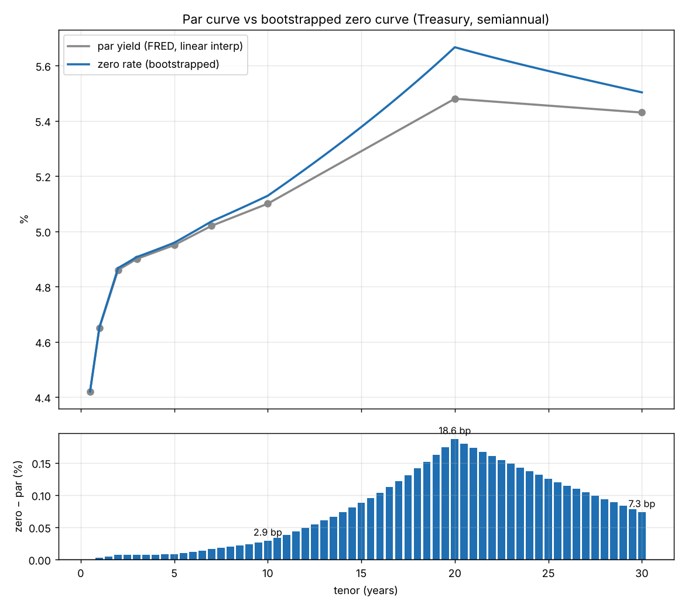

  # Fixed Income Risk Engine
  Bond pricing, yield curves and risk metrics (DV01, duration, convexity) in Python.
  ## Validation against a live Treasury quote

Quote source: WSJ Treasury Quotes, 2026-10-30. Bond: [10-31-2028], coupon [4.625]%, asked 100.033, asked yield 4.569%.

| | Quote | Model | Diff |
|---|---|---|---|
| Yield | 4.569% | 4.608% | +3.9 bp |
| Price | 100.033 | 100.106 | +0.073 |

The gap comes from three simplifications in the current model, all scheduled for the Bond class in week 2:
1. **Accrued interest** — the quote is a clean price; the model computes a dirty price.
2. **Non-integer periods** — maturity is rounded to whole half-years; the real bond has a fractional first period.
3. **Day count** — Treasuries use actual/actual; the model has no calendar.

## Par-to-zero bootstrap

FRED publishes **par yields**: the coupon at which a semiannual Treasury of that
maturity prices at 100. Discounting individual cashflows requires **zero rates**,
so the par curve is bootstrapped one half-year step at a time:

    d_n = (1 − (c/2) · Σ d_i) / (1 + c/2),   i < n

Par yields between the published tenors are linearly interpolated.

**Unit check** — par 0.5y 4% / 1y 5% / 1.5y 6%:

| tenor | par | zero |
|---|---|---|
| 0.5 | 4.000% | 4.000% |
| 1.0 | 5.000% | 5.013% |
| 1.5 | 6.000% | 6.041% |

Repricing the 1y and 1.5y par bonds off the bootstrapped curve returns
100.000 (tolerance 1e-9) — `tests/test_curve.py`.

**Live curve** — FRED, 2026-10-18 (`python -m scripts.show_bootstrap`):

| tenor | par | zero | zero − par |
|---|---|---|---|
| 0.5 | 4.420 | 4.420 | 0.0 bp |
| 2 | 4.860 | 4.867 | 0.7 bp |
| 10 | 5.100 | 5.129 | 2.9 bp |
| 20 | 5.480 | 5.666 | 18.6 bp |
| 30 | 5.430 | 5.503 | 7.3 bp |

The gap widens over the steep 10y–20y segment and narrows over the inverted
20y–30y segment, as expected.

**Known limitation**: linear interpolation on par yields. Alternatives
(linear on log-discount / piecewise-flat forwards, cubic spline) are on the roadmap.